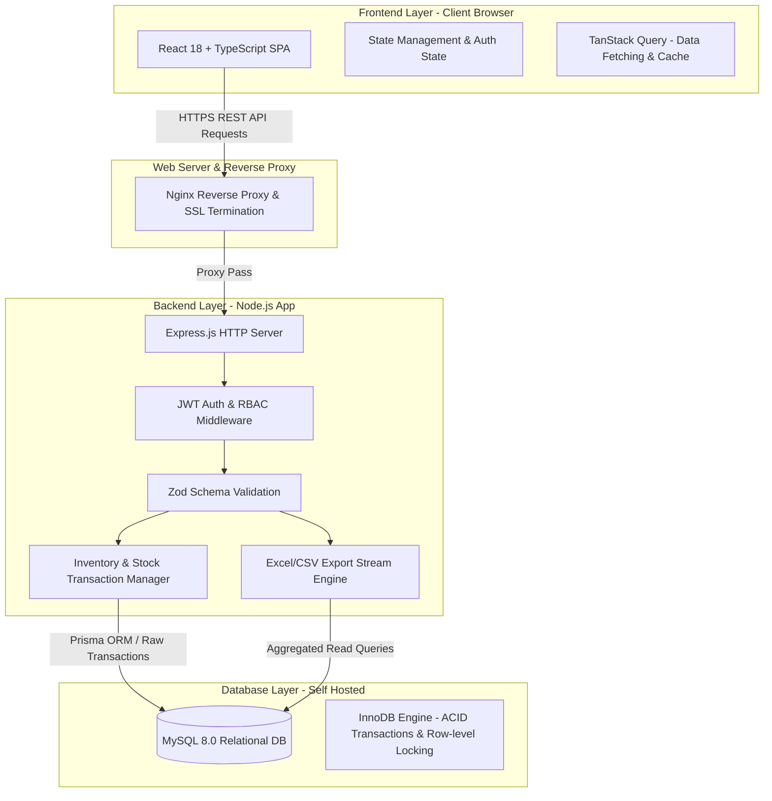
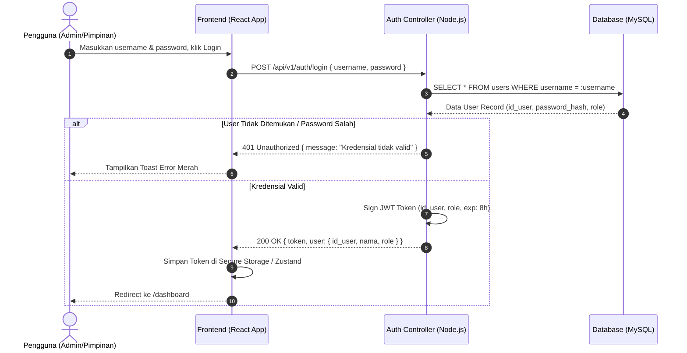
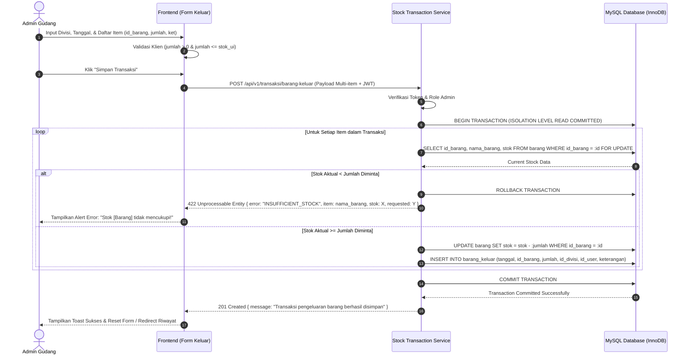
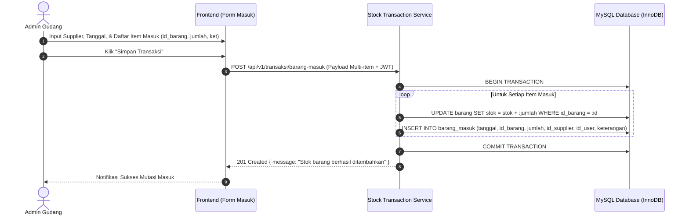
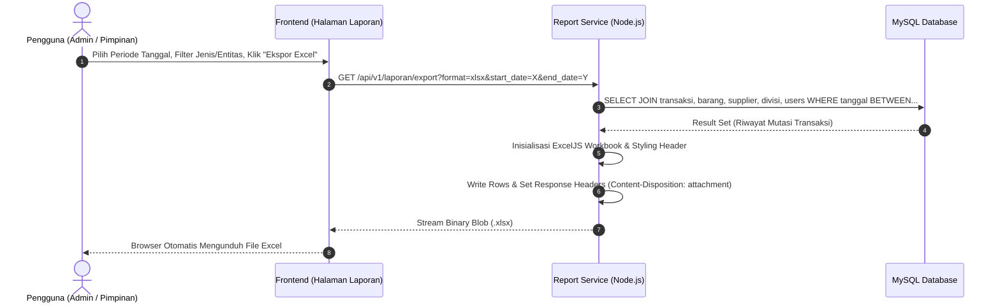
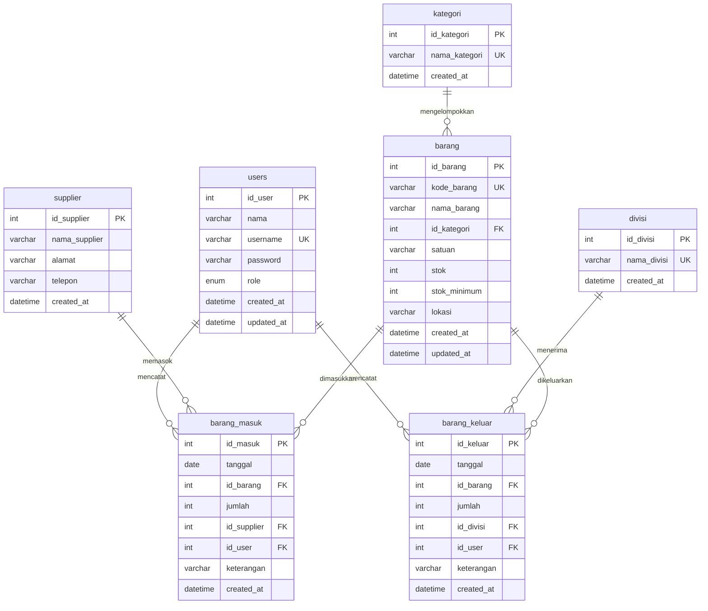

# Sistem Informasi Pencatatan Barang Masuk dan Keluar ATK

## Ringkasan Produk (Overview)

Sistem Informasi Pencatatan Barang Masuk dan Keluar Alat Tulis Kantor (ATK) adalah aplikasi inventaris berbasis web yang dirancang untuk mengotomasi pencatatan mutasi stok ATK di lingkungan kantor. Berdasarkan lampiran Flowchart dan Entity Relationship Diagram (ERD), sistem menangani alur inventaris mulai dari penerimaan ATK dari supplier (Barang Masuk), pendistribusian ke unit kerja/divisi (Barang Keluar) dengan validasi ketersediaan stok ketat secara real-time, pemantauan batas stok minimum, hingga pencetakan riwayat dan laporan berkas.

Sistem mengadopsi stack **React + TypeScript** pada frontend, **Node.js** pada backend, dan database relasional **MySQL** yang di-hosting secara mandiri (*Self Hosted*).

## Tujuan dan Batasan (Goals & Non-Goals)

### Tujuan Produk (Goals)
- **Pencatatan Transaksi Terstruktur:** Mencatat transaksi barang masuk per supplier dan barang keluar per divisi secara multi-item dengan identitas pencatat (`id_user`).
- **Validasi Stok Real-time:** Mencegah pencatatan barang keluar jika kuantitas melebihi stok yang tersedia (`jumlah_keluar > stok_tersedia`) melalui pengecekan level database dan aplikasi.
- **Peringatan Stok Minimum:** Menampilkan badge notifikasi serta tabel pemantauan barang kritis jika `stok <= stok_minimum` pada dashboard.
- **Integritas Mutasi (Audit Immutability):** Menjamin riwayat transaksi bersifat *append-only* (tidak dapat diedit/dihapus secara langsung) untuk menjaga keakuratan audit inventaris.
- **Laporan dan Analisis Data:** Memfasilitasi ekspor data mutasi dan posisi stok ke format spreadsheet (Excel/CSV).

### Batasan Produk (Non-Goals)
- Tidak mencakup modul pengadaan tender/e-procurement dan *purchase order* otomatis ke vendor luar.
- Tidak menggunakan pemindai barcode/RFID fisik; pencarian barang dilakukan via text dropdown / autocomplete konvensional.
- Tidak mendukung pembatalan atau pengubahan riwayat transaksi yang telah masuk (*no soft-delete/edit recalculation*); penyesuaian dilakukan melalui transaksi koreksi.

## Target Pengguna & Kontrol Hak Akses (User Roles & RBAC)

Aplikasi memiliki 2 peran pengguna utama dengan kredensial terotentikasi:

| Peran (*Role*) | Deskripsi | Hak Akses Utama |
|---|---|---|
| **Admin** | Petugas gudang/pengelola operasional ATK | - Manajemen Master Data (Barang, Kategori, Supplier, Divisi, User)<br>- Input Transaksi Barang Masuk (Multi-item)<br>- Input Transaksi Barang Keluar (Multi-item & Validasi Stok)<br>- Melihat Dashboard & Peringatan Stok Minimum<br>- Melihat Riwayat & Ekspor Laporan Excel/CSV |
| **Pimpinan** | Manajer/Kepala Bagian Operasional | - Akses Dashboard Eksekutif (Ringkasan stok & status kritis)<br>- Melihat Master Data & Seluruh Transaksi Barang Masuk/Keluar<br>- Meninjau Riwayat dan Mengunduh Laporan Mutasi Stok (Excel/CSV)<br>- Akses audit pengguna sistem |

## Kebutuhan Fungsional (Functional Requirements)

### 1. Modul Autentikasi & Pengguna
- **FR-AUTH-01:** Pengguna harus melakukan login menggunakan kombinasi `username` dan `password` terenkripsi.
- **FR-AUTH-02:** Sistem memvalidasi role (`admin` vs `pimpinan`) dan mengarahkan pengguna ke Dashboard dengan session JWT.
- **FR-AUTH-03:** Fitur Logout untuk mengakhiri sesi pengguna.

### 2. Modul Master Data
- **FR-MST-01:** CRUD Data Barang dengan atribut `kode_barang`, `nama_barang`, `id_kategori`, `satuan`, `stok`, `stok_minimum`, dan `lokasi`.
- **FR-MST-02:** CRUD Data Kategori (`nama_kategori`), Data Supplier (`nama_supplier`, `alamat`, `telepon`), dan Data Divisi (`nama_divisi`).
- **FR-MST-03:** Pencarian barang menggunakan *dropdown / autocomplete* cepat berdasarkan kode atau nama barang.

### 3. Modul Transaksi Barang Masuk
- **FR-IN-01:** Formulir pencatatan transaksi masuk dengan input tanggal, pemilihan supplier, dan daftar multi-item barang beserta kuantitas (`jumlah`) dan `keterangan`.
- **FR-IN-02:** Sistem secara otomatis menambahkan jumlah stok barang (`stok = stok + jumlah_masuk`) dalam transaksi database (*ACID Transaction*).
- **FR-IN-03:** Mencatat user pembuat transaksi (`id_user`).

### 4. Modul Transaksi Barang Keluar & Validasi Stok
- **FR-OUT-01:** Formulir pencatatan transaksi keluar dengan input tanggal, pemilihan divisi penerima, dan daftar multi-item barang beserta kuantitas (`jumlah`) dan `keterangan`.
- **FR-OUT-02 (Validasi Ketersediaan):** Sistem memverifikasi `jumlah_keluar <= stok_tersedia` untuk setiap item sebelum menyimpan data.
  - *Jika valid:* Kurangi stok barang (`stok = stok - jumlah_keluar`) dan simpan transaksi.
  - *Jika stok tidak cukup:* Batalkan transaksi, tampilkan pesan peringatan error spesifik: *"Jumlah keluar melebihi stok tersedia untuk barang [Nama Barang] (Stok: X, Diminta: Y)"*.

### 5. Modul Dashboard & Notifikasi Stok Minimum
- **FR-DSH-01:** Menampilkan total item ATK, total transaksi masuk/keluar bulan berjalan, dan statistik stok.
- **FR-DSH-02:** Menampilkan badge peringatan dan tabel daftar barang yang mencapai status kritis (`stok <= stok_minimum`).

### 6. Modul Riwayat & Laporan
- **FR-REP-01:** Menampilkan tabel riwayat mutasi transaksi barang masuk dan keluar dengan filter rentang tanggal, kategori, supplier, atau divisi.
- **FR-REP-02:** Fitur ekspor laporan mutasi dan stok barang ke format **Excel / CSV**.

## Kebutuhan Non-Fungsional (Non-Functional Requirements)

- **NFR-SEC-01 (Keamanan):** Password disimpan dengan algoritma hashing bcrypt / Argon2. Endpoint API diproteksi dengan otorisasi berbasis token JWT.
- **NFR-DAT-01 (Integritas Transaksi):** Pembaruan stok dan pencatatan riwayat transaksi barang masuk/keluar wajib dieksekusi di dalam database transaction isolation untuk menghindari *race conditions* atau *phantom reads*.
- **NFR-DAT-02 (Immutability):** Riwayat transaksi yang sudah di-commit bersifat permanen untuk menjamin validitas audit saldo stok.
- **NFR-PERF-01 (Performa):** Waktu respons query pencatatan transaksi dan perhitungan stok harus < 500ms.
- **NFR-USE-01 (Antarmuka):** Desain antarmuka bersih, modern, dan responsif menggunakan komponen React + TypeScript.

## Asumsi dan Pertanyaan Terbuka (Assumptions & Open Questions)

### Asumsi (Assumptions)
1. **Dukungan Multi-Item Transaksi:** Walaupun tabel di ERD dasar merepresentasikan relasi 1:N langsung antara `barang_masuk` dan `barang`, sistem backend dan database akan menggunakan relasi header-detail (`barang_masuk` & `barang_masuk_detail`, `barang_keluar` & `barang_keluar_detail`) guna mendukung kebutuhan input multi-item per surat jalan/faktur.
2. **Koreksi Stok Manual:** Karena transaksi tidak dapat diedit/dihapus, kesalahan input diselesaikan dengan input transaksi penyesuaian baru (misal transaksi masuk untuk koreksi retur/kelebihan potong).
3. **Deployment Self-Hosted:** Aplikasi dan database MySQL akan di-deploy pada server on-premise atau VPS tersendiri menggunakan reverse proxy (seperti Nginx).

### Pertanyaan Terbuka (Open Questions)
- *Saat ini tidak ada pertanyaan terbuka yang memblokir pembuatan PRD.* Seluruh klarifikasi hak akses, format ekspor (Excel/CSV), notifikasi stok minimum, dan format transaksi multi-item telah dijawab.

## Fitur Utama: Autentikasi Pengguna & Manajemen Sesi

### 1. Deskripsi & Tujuan
Modul untuk memvalidasi kredensial pengguna (`username` & `password`) sebelum memberikan akses ke dashboard dan fitur sistem sesuai peran (`admin` / `pimpinan`).

### 2. Aktor & Hak Akses
- **Aktor:** Admin, Pimpinan, Unauthenticated User.
- **Izin:** Publik untuk halaman login; Token JWT terverifikasi untuk endpoint sesi.

### 3. Pra-kondisi
- Akun pengguna telah terdaftar di tabel `users` dengan kata sandi ter-hash (Argon2/bcrypt) dan status aktif.

### 4. Alur Kerja (Flow)
- **Main Flow:**
  1. Pengguna membuka URL aplikasi dan diarahkan ke `/login`.
  2. Pengguna memasukkan `username` dan `password`, lalu menekan tombol **Masuk**.
  3. Backend memverifikasi keberadaan user dan kecocokan hash password.
  4. Jika valid, backend menerbitkan JWT access token yang memuat payload `{ id_user, username, nama, role }`.
  5. Frontend menyimpan session state dan mengarahkan pengguna ke `/dashboard`.
- **Alternative / Failure Flow:**
  - *Kredensial Tidak Valid:* Sistem merespons HTTP 401 dan menampilkan notifikasi kesalahan: *"Username atau password salah"*.
  - *Rate Limiting Triggered:* Jika login gagal berturut-turut > 5 kali dalam 1 menit, akun/IP di-throttle selama 5 menit.

### 5. Validasi & Penanganan Error
- Input `username` dan `password` wajib diisi (tidak boleh string kosong/whitespace).
- Sanitasi input untuk mencegah SQL Injection.

### 6. Kriteria Penerimaan (Acceptance Criteria)
- [ ] Pengguna dengan kredensial valid berhasil login dalam waktu < 300ms dan diarahkan ke Dashboard.
- [ ] Kredensial tidak valid menampilkan pesan kesalahan yang aman (tanpa membocorkan apakah username ada atau tidak).
- [ ] Token kedaluwarsa secara otomatis memaksa logout dan redirect ke `/login`.

## Fitur Utama: Manajemen Master Data (Barang, Kategori, Supplier, Divisi)

### 1. Deskripsi & Tujuan
Menyediakan antarmuka pengelolaan data referensi sistem ATK yang mencakup Master Barang, Kategori, Supplier, dan Divisi.

### 2. Aktor & Hak Akses
- **Admin:** Memiliki akses Create, Read, Update, Delete (CRUD).
- **Pimpinan:** Memiliki akses Read-Only (melihat daftar dan detail).

### 3. Pra-kondisi
- Pengguna telah login dengan hak akses yang sesuai.

### 4. Spesifikasi Entitas & Validasi Data
- **Master Barang:**
  - `kode_barang`: Unik, alfanumerik, wajib diisi.
  - `nama_barang`: Wajib diisi (maks 100 karakter).
  - `id_kategori`: Wajib relasi valid ke tabel `kategori`.
  - `satuan`: Wajib diisi (misal: Rim, Pcs, Box, Lusin).
  - `stok`: Integer non-negatif (`>= 0`), nilai awal default 0.
  - `stok_minimum`: Integer non-negatif (`>= 0`), penanda ambang batas peringatan stok.
  - `lokasi`: Lokasi rak/gudang penyimpanan (maks 100 karakter).
- **Master Kategori:** `nama_kategori` unik dan tidak boleh kosong.
- **Master Supplier:** `nama_supplier`, `alamat`, `telepon` (format angka standar).
- **Master Divisi:** `nama_divisi` unik (misal: Keuangan, HRD, IT, Operasional).

### 5. Alur Kerja (Flow)
- **Main Flow (Tambah Barang):**
  1. Admin membuka menu **Data Barang** dan mengklik **Tambah Barang**.
  2. Admin mengisi form (Kode, Nama, Kategori via dropdown, Satuan, Stok Minimum, Lokasi).
  3. Admin menekan **Simpan**; sistem menyimpan record ke tabel `barang`.
  4. Tabel barang memperbarui data secara reaktif dan menampilkan toast sukses.
- **Alternative / Failure Flow:**
  - *Duplicate Code:* Jika `kode_barang` sudah terdaftar, sistem mengembalikan error: *"Kode barang sudah digunakan"*.
  - *Restrict Deletion:* Barang/Kategori/Supplier/Divisi yang telah memiliki riwayat transaksi tidak dapat dihapus (*Foreign Key RESTRICT*); tampilkan modal penjelasan kepada pengguna.

### 6. Kriteria Penerimaan (Acceptance Criteria)
- [ ] Admin dapat melakukan CRUD pada seluruh master data.
- [ ] Input pencarian cepat (autocomplete dropdown) bekerja secara instan berdasarkan nama atau kode barang.
- [ ] Data yang berelasi dengan transaksi terkunci dari penghapusan keras (*hard delete*).

## Fitur Utama: Pencatatan Transaksi Barang Masuk

### 1. Deskripsi & Tujuan
Mencatat penerimaan ATK dari supplier secara multi-item dalam satu dokumen penerimaan, serta secara otomatis menambah stok fisik barang di gudang.

### 2. Aktor & Hak Akses
- **Admin:** Menginput transaksi penerimaan barang masuk.
- **Pimpinan:** Meninjau data transaksi barang masuk.

### 3. Pra-kondisi
- Master Data Supplier dan Master Barang telah tersedia di database.

### 4. Alur Kerja (Flow)
- **Main Flow:**
  1. Admin membuka menu **Barang Masuk** dan memilih **Input Transaksi Masuk**.
  2. Admin memilih tanggal transaksi dan supplier dari dropdown.
  3. Admin menambahkan satu atau lebih baris item: memilih ATK via searchable dropdown, memasukkan `jumlah` (> 0), dan `keterangan` per item/faktur.
  4. Admin menekan **Simpan Transaksi**.
  5. Backend menjalankan transaksi database (*ACID DB Transaction*):
     - Menyimpan record header transaksi masuk dengan menyertakan `id_user` pembuat.
     - Menyimpan baris detail barang masuk (`id_barang`, `jumlah`, `keterangan`).
     - Menjalankan mutasi penambahan stok: `UPDATE barang SET stok = stok + jumlah WHERE id_barang = :id`.
     - Melakukan commit transaksi.
  6. Sistem menampilkan pesan sukses dan mengosongkan form / mengarahkan ke riwayat transaksi.
- **Alternative / Failure Flow:**
  - *Item Kosong / Jumlah <= 0:* Form menolak submit dan menandai input yang tidak valid.
  - *Database Failure:* Jika salah satu query gagal, seluruh operasi di-*rollback* dan stok barang tetap utuh.

### 5. Kebijakan Immutability
- Transaksi yang sudah tersimpan **tidak dapat diubah atau dihapus** secara langsung guna mencegah selisih audit. Jika ada kekeliruan, user mencatat transaksi penyesuaian baru.

### 6. Kriteria Penerimaan (Acceptance Criteria)
- [ ] Nilai stok barang di tabel `barang` bertambah sesuai total kuantitas masuk segera setelah transaksi disimpan.
- [ ] Transaksi mencatat `id_user` dari admin yang sedang aktif.
- [ ] Formulir mendukung penambahan lebih dari 1 item barang dalam 1 kali simpan.

## Fitur Utama: Pencatatan Transaksi Barang Keluar & Validasi Stok

### 1. Deskripsi & Tujuan
Mendistribusikan ATK ke unit kerja/divisi dengan pengecekan ketersediaan stok yang ketat (*real-time stock validation*) untuk mencegah stok bernilai negatif.

### 2. Aktor & Hak Akses
- **Admin:** Menginput pengeluaran ATK.
- **Pimpinan:** Memantau distribusi ATK per divisi.

### 3. Pra-kondisi
- Divisi tujuan dan barang yang diminta terdaftar di sistem.

### 4. Alur Kerja & Mekanisme Validasi Stok
```
[Input Form Multi-item Keluar]
          │
          ▼
[Kunci Baris Barang (SELECT ... FOR UPDATE)]
          │
   ┌──────┴──────────────────────────┐
   │ Apakah stok >= jumlah_keluar?   │
   └──────┬──────────────────────────┘
     YA   │                     │ TIDAK
          ▼                     ▼
 [Potong Stok & Simpan]    [Batalkan Transaksi]
 [Commit DB Transaction]   [Rollback & Tampilkan Peringatan Stok Kurang]
```
- **Main Flow:**
  1. Admin membuka menu **Barang Keluar** dan mengklik **Input Transaksi Keluar**.
  2. Admin memilih tanggal transaksi dan Divisi penerima.
  3. Admin memilih barang dari dropdown (menampilkan info *Stok Tersedia* saat dipilih) dan menginput `jumlah` keluar.
  4. Frontend melakukan validasi awal di antarmuka (`jumlah <= stok_tersedia`).
  5. Admin menekan **Simpan Transaksi**.
  6. Backend membuka transaksi database terisolasi dan mengecek stok aktual dengan *pessimistic row locking* (`FOR UPDATE`).
  7. Jika seluruh item valid: backend memotong stok (`stok = stok - jumlah`), menyimpan riwayat detail, mencatat `id_user`, dan melakukan commit.
  8. Sistem menampilkan pesan sukses.
- **Failure Flow (Stok Tidak Mencukupi):**
  - Jika saat pengecekan backend ditemukan `jumlah_keluar > stok`, backend melakukan rollback transaksi dan mengembalikan HTTP 422 Unprocessable Entity.
  - Response body: `{ "error": "INSUFFICIENT_STOCK", "message": "Jumlah keluar melebihi stok tersedia untuk barang [Nama Barang] (Stok: X, Diminta: Y)" }`.
  - Antarmuka memunculkan pesan peringatan error visual berwarna merah dan transaksi dibatalkan.

### 5. Kriteria Penerimaan (Acceptance Criteria)
- [ ] Stok barang berkurang tepat sebesar jumlah yang dikeluarkan saat transaksi sukses.
- [ ] Sistem secara absolut menolak transaksi jika ada 1 saja item dalam batch yang melebihi stok tersedia.
- [ ] Stok fisik di database tidak pernah bernilai negatif (`stok >= 0` check constraint).

## Fitur Utama: Dashboard & Peringatan Stok Minimum

### 1. Deskripsi & Tujuan
Menyajikan ringkasan metrik inventaris ATK secara visual dan menampilkan daftar barang kritis yang memerlukan pengadaan ulang karena mencapai atau berada di bawah ambang batas `stok_minimum`.

### 2. Aktor & Hak Akses
- **Admin & Pimpinan:** Akses penuh untuk melihat ringkasan dashboard.

### 3. Komponen Dashboard
- **Kartu Metrik (Summary Cards):**
  - Total Jenis ATK Terdaftar.
  - Total Item Barang Masuk (Bulan Berjalan).
  - Total Item Barang Keluar (Bulan Berjalan).
  - Total Item Menipis (Stok <= Stok Minimum).
- **Tabel Peringatan Stok Menipis (Low Stock Alert Table):**
  - Menampilkan daftar barang dengan kondisi `stok <= stok_minimum`.
  - Kolom: Kode Barang, Nama Barang, Kategori, Sisa Stok, Stok Minimum, Satuan, Lokasi, dan Status Badge (*Kritis / Menipis*).
- **Grafik Tren Mutasi Bulanan:** Menampilkan perbandingan volume barang masuk vs barang keluar 6 bulan terakhir.

### 4. Kriteria Penerimaan (Acceptance Criteria)
- [ ] Badge angka stok menipis terbarui secara otomatis saat transaksi keluar selesai dieksekusi.
- [ ] Barang dengan `stok <= stok_minimum` disorot dengan indikator visual merah/oranye pada tabel.

## Fitur Utama: Riwayat Mutasi & Ekspor Laporan Excel/CSV

### 1. Deskripsi & Tujuan
Menyediakan rekapitulasi riwayat mutasi transaksi barang masuk dan keluar yang lengkap serta kemampuan mengunduh data dalam format file spreadsheet (**Excel / CSV**) untuk keperluan audit dan arsip kantor.

### 2. Aktor & Hak Akses
- **Admin & Pimpinan:** Meninjau riwayat transaksi, menerapkan filter, dan mengekspor laporan.

### 3. Fungsionalitas Modul
- **Filter & Pencarian Riwayat:**
  - Rentang tanggal transaksi (*Date range picker*: Tanggal Mulai s/d Tanggal Selesai).
  - Filter spesifik berdasarkan: Supplier, Divisi, atau Kategori Barang.
  - Pencarian kata kunci nama/kode barang.
- **Tampilan Riwayat Mutasi:**
  - Menampilkan tabel komprehensif: No Dokumen, Tanggal, Jenis Mutasi (Masuk/Keluar), Pihak Terkait (Supplier/Divisi), Detail Barang, Jumlah, Satuan, Petugas Pencatat (`User`), dan Keterangan.
- **Generator Ekspor Spreadsheet (Excel / CSV):**
  - Tombol **Ekspor Excel (.xlsx)** dan **Ekspor CSV (.csv)**.
  - File yang diunduh mencakup metadata ringkasan periode filter dan tabel data terstruktur rapi dengan format header siap olah.

### 4. Kriteria Penerimaan (Acceptance Criteria)
- [ ] File Excel/CSV hasil unduhan memuat data transaksi yang sesuai persis dengan parameter filter yang aktif di layar.
- [ ] Pembuatan file ekspor dengan volume hingga 10.000 baris transaksi selesai dalam waktu < 3 detik.
- [ ] Format angka, tanggal (`YYYY-MM-DD`), dan teks terformat dengan benar tanpa karakter *corrupted*.

## Alur Pengguna Keseluruhan (User Flow)

Berdasarkan diagram alur sistem (flowchart), alur interaksi pengguna terbagi menjadi beberapa siklus kerja utama:

```
[Mulai] ──> [Halaman Login]
                 │
      [Validasi Kredensial?]
       ├── TIDAK ──> [Pesan Error & Form Reset]
       └── YA
            │
      [Dashboard Utama]
            │
   ┌────────┼──────────────────────────┬────────────────────────┐
   ▼        ▼                          ▼                        ▼
[Data     [Input Transaksi           [Input Transaksi        [Riwayat &
Barang]    Barang Masuk]              Barang Keluar]          Laporan]
(CRUD)      │                          │                        │
            ▼                          ▼                        ▼
       [Pilih Supplier &          [Pilih Divisi &          [Filter Tanggal/
        Item ATK Masuk]            Item ATK Keluar]         Kategori/Entitas]
            │                          │                        │
            ▼                          ▼                        ▼
       [Auto-Tambah Stok]         [Validasi Stok:          [Ekspor Excel/
            │                      Kuantitas <= Stok?]      CSV]
            │                      ├── TIDAK ──> [Peringatan Stok Kurang]
            │                      └── YA ───> [Auto-Kurangi Stok]
            │                                       │
            └───────────────┬───────────────────────┘
                            ▼
               [Simpan Transaksi ke Database]
                            │
                            ▼
                        [Logout] ──> [Selesai]
```

### Rincian Alur Pengguna
1. **Alur Autentikasi:** Masuk ke `/login` -> Masukkan user/password -> Verifikasi sesi & role -> Redirect ke `/dashboard`.
2. **Alur Manajemen Data Barang:** Buka `/barang` -> Tambah/Ubah/Hapus/Cari data ATK -> Perbarui tabel master.
3. **Alur Penerimaan Barang Masuk:** Buka `/barang-masuk/baru` -> Pilih supplier, tanggal, item barang & kuantitas -> Simpan -> Stok bertambah otomatis -> Redirect ke riwayat.
4. **Alur Distribusi Barang Keluar:** Buka `/barang-keluar/baru` -> Pilih divisi & tanggal -> Pilih item barang -> Sistem validasi stok (`jumlah <= stok`) -> Jika valid, stok berkurang & data disimpan; jika tidak cukup, form memunculkan alert merah dan menolak simpan.
5. **Alur Monitoring & Laporan:** Pantau stok menipis di Dashboard -> Buka `/laporan` -> Atur filter periode dan kategori -> Klik **Ekspor Excel** atau **Ekspor CSV**.

## Struktur Layar & Navigasi (Screens & Navigation)

### Struktur Hirarki Halaman & Hak Akses

| URL Path | Nama Layar | Akses Role | Deskripsi & Komponen Kunci |
|---|---|---|---|
| `/login` | Layar Login | Publik | Form login, input username & password, tombol aksi, peringatan error |
| `/dashboard` | Dashboard Utama | Admin, Pimpinan | 4 Ringkasan KPI Cards, Grafik Mutasi, Tabel Alert Stok Menipis (`stok <= stok_minimum`) |
| `/barang` | Master Data Barang | Admin (CRUD), Pimpinan (Read) | Tabel ATK, bar pencarian autocomplete, filter kategori, modal Tambah/Edit Barang |
| `/kategori` | Master Kategori | Admin (CRUD), Pimpinan (Read) | Tabel daftar kategori ATK, modal Tambah/Edit Kategori |
| `/supplier` | Master Supplier | Admin (CRUD), Pimpinan (Read) | Tabel vendor ATK, kontak telepon, alamat, modal Tambah/Edit Supplier |
| `/divisi` | Master Divisi | Admin (CRUD), Pimpinan (Read) | Tabel unit kerja penerima ATK, modal Tambah/Edit Divisi |
| `/barang-masuk` | Riwayat Barang Masuk | Admin, Pimpinan | Tabel transaksi masuk, filter tanggal/supplier, tombol menuju form input |
| `/barang-masuk/baru` | Input Barang Masuk | Admin | Multi-item input builder, dropdown supplier, input jumlah, catatan faktur |
| `/barang-keluar` | Riwayat Barang Keluar | Admin, Pimpinan | Tabel distribusi ATK per divisi, filter tanggal/divisi, tombol transaksi baru |
| `/barang-keluar/baru` | Input Barang Keluar | Admin | Multi-item input builder, dropdown divisi, counter stok live, indikator validasi stok |
| `/laporan` | Laporan & Mutasi Stok | Admin, Pimpinan | Tabulasi Laporan Masuk/Keluar/Posisi Stok, Date Range Picker, Tombol Ekspor Excel & CSV |

### Navigasi Aplikasi (Sidebar Navigation)
- **Header:** Logo & Nama Sistem, Informasi Pengguna Login (`nama`, `role badge`), Tombol Logout.
- **Sidebar Menu:**
  - 📊 **Dashboard** (`/dashboard`)
  - 📦 **Master Data** (Sub-menu: Data Barang, Kategori, Supplier, Divisi)
  - 📥 **Barang Masuk** (`/barang-masuk`)
  - 📤 **Barang Keluar** (`/barang-keluar`)
  - 📑 **Laporan Mutasi** (`/laporan`)

## Kondisi Antarmuka (UI States), Desain, & Aksesibilitas

### 1. Arah Desain (Design Direction: Bersih & Modern)
- **Palet Warna:**
  - *Primary:* Indigo/Navy (`#1E3A8A`) untuk Sidebar, Header, dan Primary Buttons.
  - *Success (Barang Masuk / Stok Aman):* Emerald Green (`#059669`).
  - *Danger / Warning (Barang Keluar / Stok Kritis):* Crimson Red (`#DC2626`) dan Amber (`#D97706`).
  - *Background:* Clean Slate White/Grey (`#F8FAFC`).
- **Tipografi:** Sans-serif modern (Inter / Roboto) dengan hierarki teks jelas (H1, H2, body, label caption).

### 2. State Antarmuka (UI States)
- **Loading State:** Skeleton loader pada tabel data dan KPI cards saat data API di-fetch; spinner indikator pada tombol Simpan saat mutasi stok berlangsung.
- **Empty State:**
  - Tabel kosong menampilkan ilustrasi visual minimalis dan pesan: *"Belum ada data transaksi untuk periode ini"* beserta tombol *Cari Periode Lain* atau *Tambah Baru*.
  - Dropdown autocomplete menampilkan *"Barang tidak ditemukan"* jika kata kunci tidak cocok.
- **Error & Validation State:**
  - *Stok Kurang pada Form Keluar:* Input field dibingkai warna merah dengan teks bantuan tebal: *"Jumlah keluar (Y) melebihi stok tersedia (X)"*. Tombol Simpan di-disable sampai kuantitas diperbaiki.
  - *Server Error / Network Loss:* Toast notification merah di pojok kanan atas dengan pesan kesalahan yang informatif.

### 3. Aksesibilitas (Accessibility & Usability)
- **Kontras Warna:** Memenuhi standar rasio kontras WCAG 2.1 AA (minimal 4.5:1) untuk teks pada tombol dan badge status.
- **Navigasi Keyboard & Focus:** Mendukung navigasi penuh via `Tab`, `Enter`, dan `Esc` pada modal dialog dan dropdown autocomplete.
- **Feedback Interaktif:** Setiap aksi simpan, hapus, dan ekspor berkas memberikan konfirmasi dialog serta toast notifikasi langsung.

## Arsitektur Sistem (System Architecture)

### 1. Gambaran Arsitektur (High-Level Architecture)
Sistem Informasi Pencatatan Barang Masuk dan Keluar ATK dirancang dengan pola *Client-Server Tiered Architecture* yang modular, memisahkan lapisan presentasi (*Single Page Application*), API gateway/service logic (*RESTful Backend*), dan lapisan persistensi data relasional (*MySQL Database*).



### 2. Komponen Arsitektur
- **Client Layer:** Dibangun menggunakan **React 18 dengan TypeScript** dan Vite bundler. UI responsif dibangun menggunakan Tailwind CSS dan Shadcn UI. TanStack Query mengelola caching server state dan sinkronisasi real-time status stok.
- **Reverse Proxy Layer (Nginx):** Berfungsi menangani SSL termination, *rate limiting*, *static asset serving*, dan *forward proxy* ke backend Node.js.
- **Application Service Layer (Node.js & Express):** Mengelola otentikasi JWT, validasi skema DTO (Zod), isolasi transaksi database untuk mutasi stok, serta *streaming generator* berkas ekspor CSV/Excel (menggunakan `exceljs`).
- **Persistence Layer (MySQL 8.0):** Menggunakan storage engine InnoDB untuk menjamin integritas ACID, *foreign key constraints*, serta *row-level locking* (`SELECT ... FOR UPDATE`) saat verifikasi ketersediaan stok ATK.

## Pilihan Teknologi & Analisis Trade-offs (Tech Stack & Trade-offs)

### 1. Rincian Pemilihan Teknologi (Technology Stack)

| Lapisan (*Layer*) | Teknologi Terpilih | Versi / Dependensi Kunci | Justifikasi Pemilihan |
|---|---|---|---|
| **Frontend** | React + TypeScript | React 18, TypeScript 5.x, Vite, Tailwind CSS, Lucide React, TanStack Query | Menjamin *type safety* antarmuka, *developer experience* cepat, rendering komponen modular, dan UX dashboard yang interaktif. |
| **State & Fetching** | Zustand & TanStack Query | Zustand 4.x, @tanstack/react-query 5.x | State auth global yang ringan dan pengelolaan cache data server otomatis untuk sinkronisasi mutasi data. |
| **Backend** | Node.js + Express.js (TypeScript) | Node.js 20 LTS, Express 4.x, ts-node-dev | Lingkungan runtime asynchronous non-blocking yang efisien untuk I/O operasi transaksi inventaris dan ekspor berkas data. |
| **Validasi & Keamanan** | Zod, bcrypt, jsonwebtoken | Zod 3.x, bcryptjs, jsonwebtoken 9.x | Validasi request payload yang ketat di runtime & compile time; hashing password standar industri. |
| **ORM / Data Access** | Prisma ORM | Prisma 5.x Client & Migration Engine | Type-safe query builder, migrasi database terstruktur, dan dukungan native transaksi interaktif (`prisma.$transaction`). |
| **Database** | MySQL | MySQL 8.0 (InnoDB) | Database relasional stabil, kepatuhan ACID tinggi, mendukung *pessimistic locking* dan *foreign key integrity* sesuai ERD. |
| **Ekspor Berkas** | ExcelJS & Fast-CSV | ExcelJS 4.x, fast-csv 4.x | Menghasilkan berkas spreadsheet native `.xlsx` dan `.csv` secara performan dengan memori rendah. |
| **Deployment** | Self Hosted (Linux / Docker) | Docker, Docker Compose, Nginx Reverse Proxy | Memenuhi kebutuhan infrastruktur *on-premise / private VPS* mandiri tanpa ketergantungan *vendor cloud lock-in*. |

### 2. Analisis Trade-offs Arsitektur
- **MySQL + Pessimistic Row Locking vs. Optimistic Locking:**
  - *Pilihan:* Pessimistic Locking (`SELECT ... FOR UPDATE` dalam transaksi ACID).
  - *Trade-off:* Sedikit menurunkan konkurensi throughput pada barang yang sama, namun menjamin 100% konsistensi stok agar tidak terjadi *negative stock* / *overselling* saat beberapa admin mencatat barang keluar secara simultan.
- **ExcelJS Stream vs. In-memory Array Generation:**
  - *Pilihan:* Stream data langsung ke HTTP response.
  - *Trade-off:* Memerlukan penanganan stream pipeline, namun mencegah lonjakan penggunaan RAM (OOM) pada server saat mencetak puluhan ribu baris riwayat transaksi.
- **SPA Client-side Routing vs. SSR (Next.js):**
  - *Pilihan:* React SPA via Vite.
  - *Trade-off:* Initial loading bundle sedikit lebih besar dibanding static HTML, namun arsitektur SPA sangat cocok untuk sistem informasi internal (intranet/dashboard) yang tidak membutuhkan Search Engine Optimization (SEO).

## Diagram Alur Transaksi (Sequence Diagrams)

### 1. Alur Autentikasi Pengguna (Login Sequence)



### 2. Alur Transaksi Pencatatan Barang Keluar & Validasi Stok



### 3. Alur Transaksi Pencatatan Barang Masuk



### 4. Alur Ekspor Laporan Excel/CSV



## Skema Database & Relasi Tabel (Database Schema & Relations)

### 1. Desain Relasional Database (MySQL 8.0 / InnoDB)
Struktur basis data dirancang mengacu pada Entity Relationship Diagram (ERD) acuan dengan penambahan indeks performa dan integritas referensial foreign key untuk mendukung mutasi inventaris ATK yang aman dan konsisten.



### 2. Aturan Integritas & Constraint Database
- **Check Constraint:**
  - Tabel `barang`: `CONSTRAINT chk_barang_stok CHECK (stok >= 0)` (mencegah stok bernilai negatif secara fisik di database).
  - Tabel `barang`: `CONSTRAINT chk_barang_min CHECK (stok_minimum >= 0)`.
  - Tabel `barang_masuk`: `CONSTRAINT chk_masuk_jumlah CHECK (jumlah > 0)`.
  - Tabel `barang_keluar`: `CONSTRAINT chk_keluar_jumlah CHECK (jumlah > 0)`.
- **Foreign Key Actions:**
  - `ON DELETE RESTRICT`: Menolak penghapusan data master `barang`, `kategori`, `supplier`, `divisi`, atau `users` apabila record sudah tercatat di riwayat mutasi transaksi.
- **Optimasi Indeks:**
  - Index pada `barang_masuk(tanggal)`, `barang_masuk(id_barang)`, `barang_masuk(id_supplier)`.
  - Index pada `barang_keluar(tanggal)`, `barang_keluar(id_barang)`, `barang_keluar(id_divisi)`.
  - Composite index `barang(stok, stok_minimum)` untuk query cepat dashboard stok menipis.

## Desain API & Spesifikasi Endpoint (API Design)

### 1. Standar Format API
- Base URL: `/api/v1`
- Autentikasi: `Authorization: Bearer <jwt_token>` pada header HTTP.
- Format Response Sukses: `{ "success": true, "data": ... }`
- Format Response Error: `{ "success": false, "error": { "code": "STRING_CODE", "message": "Pesan deskriptif" } }`

### 2. Daftar Endpoint RESTful

#### A. Autentikasi
- `POST /api/v1/auth/login`
  - **Request Body:** `{ "username": "admin1", "password": "secret123" }`
  - **Response (200 OK):** `{ "success": true, "data": { "token": "jwt_str", "user": { "id_user": 1, "nama": "Admin ATK", "role": "admin" } } }`
  - **Response (401 Unauthorized):** `{ "success": false, "error": { "code": "AUTH_INVALID", "message": "Username atau password salah" } }`
- `GET /api/v1/auth/me`
  - **Header:** `Bearer <token>`
  - **Response (200 OK):** Data profil pengguna yang sedang login.

#### B. Master Data Barang
- `GET /api/v1/barang`
  - **Query Params:** `search`, `id_kategori`, `page`, `limit`
  - **Response (200 OK):** Daftar barang beserta relasi nama kategori dan status stok.
- `POST /api/v1/barang` *(Admin Only)*
  - **Request Body:** `{ "kode_barang": "ATK-001", "nama_barang": "Kertas A4 80gr", "id_kategori": 1, "satuan": "Rim", "stok": 0, "stok_minimum": 10, "lokasi": "Rak A1" }`
  - **Response (201 Created):** Objek data barang yang berhasil dibuat.
- `PUT /api/v1/barang/:id` *(Admin Only)*
  - **Request Body:** Update parsial/penuh properti barang (tidak termasuk manipulasi langsung stok tanpa transaksi).
- `DELETE /api/v1/barang/:id` *(Admin Only)*
  - **Response (200 OK / 409 Conflict):** Dihapus jika belum ada transaksi, atau error jika berelasi (`RESTRICT`).

#### C. Master Data Kategori, Supplier, & Divisi
- `GET /api/v1/kategori` | `POST /api/v1/kategori` | `PUT /api/v1/kategori/:id` | `DELETE /api/v1/kategori/:id`
- `GET /api/v1/supplier` | `POST /api/v1/supplier` | `PUT /api/v1/supplier/:id` | `DELETE /api/v1/supplier/:id`
- `GET /api/v1/divisi` | `POST /api/v1/divisi` | `PUT /api/v1/divisi/:id` | `DELETE /api/v1/divisi/:id`

#### D. Transaksi Barang Masuk
- `POST /api/v1/transaksi/barang-masuk` *(Admin Only)*
  - **Request Body (Batch Multi-item):**
    ```json
    {
      "tanggal": "2026-09-20",
      "id_supplier": 1,
      "items": [
        { "id_barang": 101, "jumlah": 50, "keterangan": "Faktur #INV-001" },
        { "id_barang": 102, "jumlah": 20, "keterangan": "Faktur #INV-001" }
      ]
    }
    ```
  - **Response (201 Created):** `{ "success": true, "message": "2 item barang masuk berhasil dicatat dan stok bertambah" }`
- `GET /api/v1/transaksi/barang-masuk`
  - **Query Params:** `start_date`, `end_date`, `id_supplier`, `id_barang`, `page`, `limit`

#### E. Transaksi Barang Keluar & Validasi Stok
- `POST /api/v1/transaksi/barang-keluar` *(Admin Only)*
  - **Request Body (Batch Multi-item):**
    ```json
    {
      "tanggal": "2026-09-20",
      "id_divisi": 2,
      "items": [
        { "id_barang": 101, "jumlah": 5, "keterangan": "Permintaan Divisi IT" },
        { "id_barang": 103, "jumlah": 12, "keterangan": "Permintaan Divisi IT" }
      ]
    }
    ```
  - **Response (201 Created):** `{ "success": true, "message": "Transaksi pengeluaran barang berhasil disimpan" }`
  - **Response (422 Unprocessable Entity - Stok Kurang):**
    ```json
    {
      "success": false,
      "error": {
        "code": "INSUFFICIENT_STOCK",
        "message": "Jumlah keluar melebihi stok tersedia untuk barang Spidol Whiteboard (Stok: 8, Diminta: 12)",
        "details": { "id_barang": 103, "nama_barang": "Spidol Whiteboard", "stok_tersedia": 8, "jumlah_diminta": 12 }
      }
    }
    ```
- `GET /api/v1/transaksi/barang-keluar`
  - **Query Params:** `start_date`, `end_date`, `id_divisi`, `id_barang`, `page`, `limit`

#### F. Dashboard & Laporan
- `GET /api/v1/dashboard/summary`
  - **Response (200 OK):** Total ATK, transaksi masuk bulan ini, transaksi keluar bulan ini, total item stok kritis.
- `GET /api/v1/dashboard/low-stock`
  - **Response (200 OK):** Daftar barang dengan kriteria `stok <= stok_minimum`.
- `GET /api/v1/laporan/export`
  - **Query Params:** `type=masuk|keluar|mutasi`, `format=xlsx|csv`, `start_date`, `end_date`, `id_kategori`, `id_supplier`, `id_divisi`
  - **Response (200 OK):** File binary stream download (`application/vnd.openxmlformats-officedocument.spreadsheetml.sheet` atau `text/csv`).

## Variabel Lingkungan (Environment Variables)

Daftar kunci konfigurasi lingkungan yang dibutuhkan untuk menjalankan sistem pada level server backend dan client frontend tanpa menyertakan nilai rahasia (secrets).

### Backend (.env)
- `NODE_ENV`
- `PORT`
- `DATABASE_URL`
- `JWT_SECRET`
- `JWT_EXPIRES_IN`
- `CORS_ORIGIN`
- `LOG_LEVEL`

### Frontend (.env)
- `VITE_API_BASE_URL`
- `VITE_APP_NAME`
- `VITE_APP_VERSION`

## Struktur Proyek (Project Structure)

Struktur monorepo/folder terpadu berbasis **React + TypeScript** di sisi client dan **Node.js + Express + TypeScript** di sisi server.

```
sistem-atk/
├── docker-compose.yml
├── nginx.conf
├── README.md
├── client/
│   ├── index.html
│   ├── package.json
│   ├── tsconfig.json
│   ├── tsconfig.node.json
│   ├── vite.config.ts
│   ├── tailwind.config.ts
│   └── src/
│       ├── main.tsx
│       ├── App.tsx
│       ├── routes/
│       │   ├── AppRoutes.tsx
│       │   └── ProtectedRoute.tsx
│       ├── api/
│       │   ├── client.ts
│       │   ├── auth.ts
│       │   ├── barang.ts
│       │   ├── transaksi.ts
│       │   └── dashboard.ts
│       ├── components/
│       │   ├── ui/
│       │   ├── layout/
│       │   │   ├── Navbar.tsx
│       │   │   ├── Sidebar.tsx
│       │   │   └── MainLayout.tsx
│       │   ├── common/
│       │   │   ├── Table.tsx
│       │   │   ├── SearchInput.tsx
│       │   │   └── Modal.tsx
│       │   └── stock/
│       │       └── LowStockBadge.tsx
│       ├── pages/
│       │   ├── auth/LoginPage.tsx
│       │   ├── dashboard/DashboardPage.tsx
│       │   ├── master/
│       │   │   ├── BarangPage.tsx
│       │   │   ├── KategoriPage.tsx
│       │   │   ├── SupplierPage.tsx
│       │   │   └── DivisiPage.tsx
│       │   ├── transaksi/
│       │   │   ├── BarangMasukPage.tsx
│       │   │   ├── InputBarangMasukPage.tsx
│       │   │   ├── BarangKeluarPage.tsx
│       │   │   └── InputBarangKeluarPage.tsx
│       │   └── laporan/LaporanPage.tsx
│       ├── store/
│       │   └── useAuthStore.ts
│       ├── types/
│       │   ├── auth.types.ts
│       │   ├── inventory.types.ts
│       │   └── api.types.ts
│       └── utils/
│           ├── formatters.ts
│           └── exportHelper.ts
└── server/
    ├── package.json
    ├── tsconfig.json
    ├── prisma/
    │   ├── schema.prisma
    │   ├── seed.ts
    │   └── migrations/
    └── src/
        ├── server.ts
        ├── app.ts
        ├── config/
        │   ├── db.ts
        │   └── env.ts
        ├── middleware/
        │   ├── auth.middleware.ts
        │   ├── role.middleware.ts
        │   ├── validate.middleware.ts
        │   └── error.middleware.ts
        ├── routes/
        │   ├── index.ts
        │   ├── auth.routes.ts
        │   ├── master.routes.ts
        │   ├── transaksi.routes.ts
        │   ├── dashboard.routes.ts
        │   └── report.routes.ts
        ├── controllers/
        │   ├── auth.controller.ts
        │   ├── master.controller.ts
        │   ├── transaksi.controller.ts
        │   ├── dashboard.controller.ts
        │   └── report.controller.ts
        ├── services/
        │   ├── auth.service.ts
        │   ├── inventory.service.ts
        │   ├── transaction.service.ts
        │   └── export.service.ts
        ├── schemas/
        │   ├── auth.schema.ts
        │   ├── master.schema.ts
        │   └── transaction.schema.ts
        ├── types/
        │   └── index.d.ts
        └── utils/
            ├── logger.ts
            └── apiResponse.ts
```

## Fase Implementasi (Implementation Phases)

### Fase 1: Fondasi Proyek, Database & Autentikasi
- Inisialisasi struktur monorepo (`client` Vite React-TS dan `server` Express-TS).
- Konfigurasi skema database MySQL melalui Prisma ORM (`users`, `kategori`, `supplier`, `divisi`, `barang`, `barang_masuk`, `barang_keluar`).
- Jalankan database migration & seeder untuk akun awal (`admin` & `pimpinan`) serta data kategori dasar.
- Implementasi modul autentikasi: Hashing password (bcrypt), JWT generation, route protection, dan state auth di Zustand.

### Fase 2: Manajemen Master Data & Autocomplete Search
- Pembuatan API CRUD Master Data (Barang, Kategori, Supplier, Divisi) dengan validasi Zod.
- Pembangunan UI Master Data di React: Tabel responsif, modal form CRUD, dan komponen *search dropdown / autocomplete* konvensional.
- Implementasi aturan proteksi foreign key (`RESTRICT`) agar master data yang terkait transaksi tidak dapat dihapus.

### Fase 3: Transaksi Inventaris & Engine Validasi Stok
- Implementasi API Transaksi Masuk (Multi-item) dengan penambahan stok otomatis dalam database transaction.
- Implementasi API Transaksi Keluar (Multi-item) dengan mekanisme *pessimistic locking* (`FOR UPDATE`) dan validasi stok (`jumlah_keluar <= stok_tersedia`).
- Pembangunan UI Form Transaksi Masuk & Keluar: Builder baris multi-item dinamis, kalkulasi stok live di frontend, dan handling error `INSUFFICIENT_STOCK` (HTTP 422).

### Fase 4: Dashboard, Peringatan Stok Minimum, & Ekspor Laporan
- Pembangunan agregasi API Dashboard: KPI cards, tren mutasi, dan query daftar stok kritis (`stok <= stok_minimum`).
- Integrasi komponen UI Dashboard: Badge visual dan tabel peringatan stok menipis.
- Implementasi modul Ekspor Spreadsheet: Streaming file Excel (`.xlsx` via ExcelJS) dan CSV (`.csv` via fast-csv) berdasarkan filter periode, supplier, atau divisi.

### Fase 5: Pengujian, Optimasi & Deployment
- Menjalankan unit testing dan integration test pada transaksi mutasi stok & isolasi konkurensi.
- Konfigurasi file `docker-compose.yml` (Nginx, Node.js App, MySQL).
- Setup deployment *Self-Hosted* pada server target dengan Nginx reverse proxy dan SSL.

## Kriteria Penerimaan Terinci (Acceptance Criteria)

Daftar kriteria keberhasilan yang wajib dipenuhi oleh sistem:

- [ ] **Autentikasi & RBAC:** Admin dan Pimpinan dapat login sesuai kredensialnya. Token JWT membatasi hak akses (hanya Admin yang dapat melakukan aksi tulis/tambah transaksi).
- [ ] **Integritas Master Data:** Kode barang bersifat unik. Penghapusan barang yang memiliki relasi transaksi berhasil ditolak sistem (*foreign key restriction*).
- [ ] **Pencatatan Barang Masuk:** Transaksi multi-item barang masuk berhasil tersimpan, menambah nilai `stok` pada tabel `barang`, dan mencatat relasi supplier serta user pencatat.
- [ ] **Validasi Ketat Barang Keluar:**
  - Jika `jumlah_keluar <= stok`, transaksi berhasil dan stok fisik berkurang tepat sesuai jumlah keluar.
  - Jika `jumlah_keluar > stok`, sistem membatalkan transaksi (*rollback*), mengembalikan status 422, dan menampilkan pesan peringatan stok kurang.
  - Nilai kolom `stok` pada tabel `barang` tidak pernah bernilai di bawah 0 (`CHECK (stok >= 0)`).
- [ ] **Immutability Transaksi:** Riwayat transaksi masuk dan keluar tidak menyediakan opsi ubah/hapus langsung pada antarmuka maupun API publik.
- [ ] **Peringatan Stok Minimum:** Dashboard menampilkan badge peringatan dan tabel daftar barang yang memiliki `stok <= stok_minimum`.
- [ ] **Ekspor Laporan (Excel / CSV):** Laporan mutasi berhasil diunduh dalam format `.xlsx` dan `.csv` sesuai rentang tanggal dan filter entitas yang dipilih.

## Strategi Pengujian (Testing Strategy)

### 1. Unit Testing
- **Cakupan:** Validasi skema Zod (payload transaksi & master data), helper perhitungan stok, format penanggalan, dan generator baris file Excel/CSV.
- **Tools:** Vitest / Jest.

### 2. Integration Testing (API & Database)
- **Cakupan:**
  - Pengujian flow login & verifikasi JWT middleware.
  - Pengujian transaksi barang masuk: Memastikan record transaksi masuk tercipta dan stok bertambah.
  - Pengujian transaksi barang keluar: Memastikan pemotongan stok valid dan penolakan saat stok tidak mencukupi.
  - Pengujian konkurensi: Simulasi 2 request barang keluar simultan pada item yang sama untuk memastikan tidak terjadi *negative stock* (race condition).
- **Tools:** Supertest, Vitest, Test Database MySQL.

### 3. End-to-End (E2E) Testing
- **Cakupan:**
  - Skenario input barang masuk -> cek penambahan stok di master barang -> input transaksi keluar -> cek pengurangan stok & verifikasi laporan mutasi.
  - Skenario validasi: Percobaan input barang keluar melebihi stok -> verifikasi munculnya pesan error visual di form.
- **Tools:** Playwright.

## Infrastruktur & Deployment (Deployment)

Target deployment adalah arsitektur **Self-Hosted** menggunakan container Docker pada Linux VPS atau server on-premise kantor.

### 1. Konfigurasi Container (Docker Compose)
- **Service 1 - `db`:** MySQL 8.0 image, volume persistensi `/var/lib/mysql`, default InnoDB engine.
- **Service 2 - `api`:** Node.js 20 LTS runtime, menjalankan migrasi database otomatis saat startup (`prisma migrate deploy`), menjalankan server Express di internal port `5000`.
- **Service 3 - `web`:** Nginx reverse proxy yang menyajikan static build React SPA (`/dist`) dan mem-forward path `/api` ke container backend `api:5000`.

### 2. Panduan Build & Run Server
```bash
# 1. Clone repository & persiapkan .env
cp .env.example .env

# 2. Jalankan seluruh container stack
docker compose up -d --build

# 3. Eksekusi database seeder awal (jika diperlukan)
docker compose exec api npm run prisma:seed
```

### 3. Backup Database Mandiri
- Script cron job harian untuk dump database MySQL: `mysqldump -u root -p sistem_atk > /backup/atk_$(date +%F).sql`.

## Pencatatan Log & Monitoring (Analytics & Logging)

### 1. Application Logging (Backend)
- Menggunakan pustaka logging terstruktur (**Winston** / **Pino**).
- Tingkatan Log (*Log Levels*):
  - `INFO`: Pencatatan login pengguna, transaksi barang masuk berhasil, transaksi barang keluar berhasil, ekspor laporan.
  - `WARN`: Upaya pengeluaran barang yang gagal karena `INSUFFICIENT_STOCK`, login gagal (kredensial salah).
  - `ERROR`: Kesalahan koneksi database MySQL, exception unhandled runtime.
- Format Log: JSON standar dengan metadata `{ timestamp, level, userId, path, method, ip, message }`.

### 2. Audit Trail Mutasi Stok
- Setiap record pada tabel `barang_masuk` dan `barang_keluar` secara permanen merekam timestamp (`created_at`) dan identitas operator (`id_user`), sehingga seluruh alur mutasi stok dapat diaudit secara akurat kapan saja.

## Instruksi Agen Pengkodean AI (AI Coding Agent Instructions)

Panduan wajib bagi AI coding agent saat memproses dan mengimplementasikan kode pada repositori ini:

1. **Kepatuhan TypeScript & Stack:** Seluruh berkas frontend wajib berekstensi `.ts` atau `.tsx` dengan strict type checking aktif; backend wajib menggunakan Node.js TypeScript. Jangan membuat atau mencampur berkas `.js` / `.jsx`.
2. **Database Transaction Mandiri:** Operasi penambahan stok (`barang_masuk`) dan pengurangan stok (`barang_keluar`) **wajib** dibungkus dalam `prisma.$transaction` atau raw transaction InnoDB. Selalu kunci baris data barang menggunakan `FOR UPDATE` saat memvalidasi stok barang keluar.
3. **Prinsip Validasi Stok (Zero Tolerance for Negative Stock):** Jangan pernah izinkan pemotongan stok jika `jumlah > stok`. Kembalikan HTTP 422 dengan format error JSON yang seragam jika stok kurang.
4. **Immutability Transaksi:** Jangan membuat endpoint `PUT` atau `DELETE` untuk record transaksi `barang_masuk` dan `barang_keluar` yang sudah terjadi.
5. **Pencarian Autocomplete:** Gunakan text dropdown / autocomplete konvensional untuk memilih barang, supplier, dan divisi. Jangan menambahkan library barcode scanner fisik.